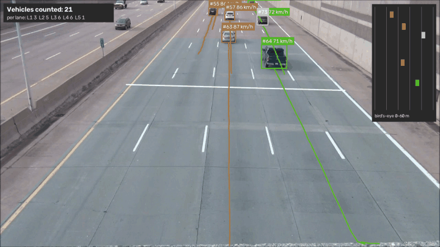
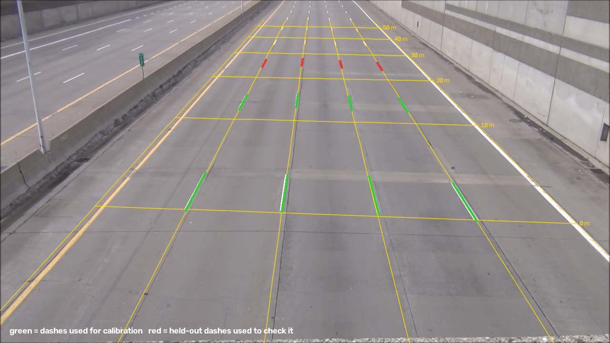
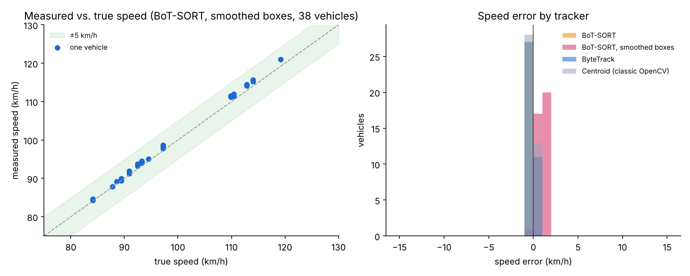
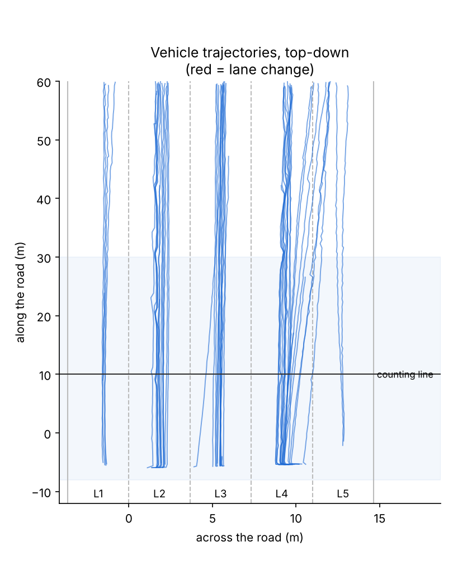
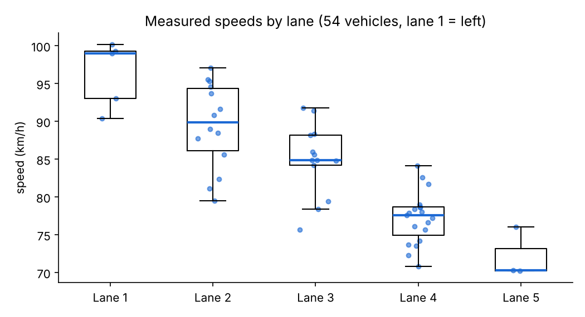

# Vehicle Tracking and Speed Estimation

This tracks every vehicle seen by a fixed traffic camera, maps its path onto the road in metres and measures its speed in km/h. From that it produces traffic statistics: counts and flow per lane, 85th-percentile speeds and lane changes. It's the kind of measurement used in traffic monitoring and roadside sensing, and as reference data when testing automated driving.


<sub>Real freeway footage from an overpass. Box colour shows speed (green slower, red faster). Speeds are shown live inside the calibrated zone and afterwards as the vehicle's measured speed. Top right: bird's-eye view of the first 60 m.</sub>

My other projects ([object detection](https://github.com/souadessemyhij1999/automotive-object-detection), [road segmentation](https://github.com/souadessemyhij1999/road-scene-segmentation) and the [driving perception system](https://github.com/souadessemyhij1999/driving-perception-system)) all look out from the car. This one looks at traffic from the roadside instead.

## How it works

```
 video frame ──► YOLO26-s detector (vehicles only, run once and cached)
                     │
                     ▼
               tracker: Centroid (classic OpenCV)  |  ByteTrack  |  BoT-SORT
                     │   identity from the tracker, position from the raw detection
                     ▼
         bottom centre of the box (where the car meets the road)
                     │   homography calibrated from lane markings
                     ▼
         road coordinates in metres ─► robust speed fit (Theil-Sen) inside the calibrated zone
                                    ─► lane, lane changes, counting line, trajectories
```

The steps in a bit more detail:

1. **Empty road.** Taking the per-pixel median of 82 frames removes all the moving vehicles. I use that image for calibration and for the test bench.
2. **Calibration from lane markings.** US interstate markings have standard sizes (MUTCD): 3.05 m dashes every 12.19 m, and 3.66 m wide lanes. The dashes are found automatically and their corners are used to fit a pixel-to-metre homography.
3. **Speed** is the slope of a robust straight-line fit of distance along the road over time. I only use the stretch where I could check the calibration (−8 m to +30 m).
4. **Lane changes** count only if a vehicle moves at least 2.5 m sideways and ends up in a different lane, judged on short smoothed windows.
5. **Test bench.** Real traffic video has no "true" speeds or IDs to compare against, so I made a test video myself: the empty road with real vehicle cut-outs replayed at known speeds, lanes and lane changes, drawn with the calibrated perspective. That gave me ground truth to score the trackers against.

## Results

### Calibration, checked on markings the fit didn't use

I fitted on the 2 nearest rows of dashes (16 corner points) and tested on the next row, 24–27 m away:

| Check on held-out dashes | Measured | Standard | Error |
|---|---|---|---|
| Dash length | 3.06 m | 3.05 m | ≤ 7 cm |
| Lane width | 3.62 m | 3.66 m | ≤ 10 cm |
| Dash position along the road | 0.45 m short at 24 m | – | about 1.8% |


<sub>Yellow: metric grid (3.66 m lanes × 10 m) projected back into the image. Green: dashes used for the fit. Red: held-out dashes.</sub>

### Test bench: trackers against ground truth

25 seconds, 38 vehicles, 9 lane changes, true speeds between 84 and 119 km/h. Standard tracking metrics from [py-motmetrics](https://github.com/cheind/py-motmetrics), counted up to 50 m:

| Tracker | MOTA | IDF1 | ID switches | Vehicles counted (true: 38) | Mean abs. speed error | Speed bias | Lane changes found (of 9) |
|---|---|---|---|---|---|---|---|
| Centroid (classic OpenCV) | 0.951 | 0.866 | 34 | 41 | 0.18 km/h | −0.09 | 8 |
| ByteTrack, Kalman-smoothed boxes | 0.821 | 0.908 | 3 | 38 | 0.98 km/h | +0.98 | 9 |
| ByteTrack | 0.947 | 0.971 | 3 | 38 | 0.13 km/h | −0.08 | 9 |
| BoT-SORT, Kalman-smoothed boxes | 0.952 | 0.975 | 1 | 38 | 0.97 km/h | +0.97 | 9 |
| **BoT-SORT** (the one I used) | **0.949** | **0.974** | **1** | **38** | **0.14 km/h** | −0.08 | **9, none false** |



Detection recall was 99.8–100% between 0 and 50 m, and 92.5% in the first few metres, where vehicles are cut off at the bottom of the image.

### Real freeway clip

33 seconds of footage, 54 vehicles measured, all of them counted at the counting line.

| Lane | Vehicles | Flow (veh/h)* | Mean speed | Median | 85th percentile |
|---|---|---|---|---|---|
| Lane 1 (left, fast) | 5 | 548 | 96.4 km/h | 99.0 | 99.7 |
| Lane 2 | 14 | 1,535 | 89.5 km/h | 89.9 | 95.3 |
| Lane 3 | 13 | 1,425 | 84.9 km/h | 84.9 | 88.9 |
| Lane 4 | 19 | 2,083 | 77.2 km/h | 77.6 | 79.8 |
| Lane 5 (right) | 3 | 329 | 72.2 km/h | 70.3 | 74.3 |
| **All** | **54** | | **83.7 km/h** | **83.3** | **93.0** |

<sub>*Flow is extrapolated from 33 seconds, so only take it as a rough order of magnitude. The 85th-percentile speed is the figure traffic engineers normally use when setting speed limits.</sub>

| Trajectories on the road (top-down) | Speeds by lane |
|---|---|
|  |  |

## What I learned

For counting traffic, keeping the right identity matters more than getting the position exactly right. The simple centroid tracker places boxes well (good MOTA, accurate speeds), but it switched IDs 34 times and counted 41 vehicles instead of 38, 8% too many. BoT-SORT counted exactly 38 with a single ID switch.

The test bench found a bias I wouldn't have noticed on real video. When I used the trackers' own Kalman-smoothed boxes, every speed came out about 1 km/h too fast. Their motion model assumes constant speed in pixels, but a car driving away gets slower in the image because of perspective, so the filter overshoots. Taking the ID from the tracker but the position from the raw detection removed the bias (+0.98 to −0.08 km/h) and also raised ByteTrack's MOTA from 0.82 to 0.95.

My first lane-change rule was wrong too. It compared one-second windows, but at 30 m/s a second is 30 m of road, so the lane change got averaged away and it only found 1 of 9. With 0.3 s windows on a smoothed path it found 9 of 9 with no false ones.

A looser version of the rule flagged 3 "lane changes" on the real clip that were really just cars drifting about 1 m along a lane line. With the 2.5 m rule there are none. The biggest sideways move of any vehicle in the clip was 1.8 m.

The real traffic looks plausible: speeds go down steadily from the fast lane (96 km/h) to the right lane (72 km/h), and lane 4 is the busiest. That doesn't prove anything, but it's what you'd expect on a freeway.

On the real road, accuracy is limited by the calibration, not by the tracking. On the bench the geometry is perfect, so the errors are tiny (0.14 km/h). On the real road the held-out dash row comes out about 1.8% short, so I'd estimate real speeds are only accurate to about ±2% (roughly ±2 km/h). That's more than 10 times the tracking error, so better calibration is where I'd put more work.

## Project structure

```
traffic-speed-tracking/
├── configs/road_homography.yaml   # pixel -> metre mapping + held-out validation results
├── src/
│   ├── data.py                    # downloads the freeway clip
│   ├── calibrate.py               # empty road, lane-dash detection, homography, validation
│   ├── tracking.py                # cached detection + Centroid / ByteTrack / BoT-SORT
│   ├── road.py                    # metres, lanes, speed fit, lane-change rule
│   ├── bench.py                   # test video with exact ground truth
│   ├── evaluate_bench.py          # MOTA / IDF1 / counts / speed / lane-change scores
│   └── analyze_freeway.py         # real clip: annotated video, statistics, charts
├── results/
│   ├── bench/                     # ground truth, tracker comparison, speed errors, lane changes
│   └── freeway/                   # vehicles.csv, lane_summary.csv, summary.json
└── assets/                        # README images and demo animation
```

## Running it

```bash
pip install -r requirements.txt
python src/data.py               # download the freeway clip
python src/calibrate.py          # homography from lane markings
python src/analyze_freeway.py    # track, measure speeds, statistics (detection takes ~8 min on a laptop CPU)
python src/bench.py              # build the test bench
python src/evaluate_bench.py     # score the trackers against ground truth
```

## Limitations and next steps

- The calibration is only checked up to about 27 m, because dashes further away are just a few pixels long. Speeds are measured inside that zone, and sideways positions drift a bit beyond 45 m on the right-hand lanes.
- The test bench is cleaner than reality. Constant speeds, perfect geometry and pasted-in vehicles mean it tests the tracking and measurement logic, not calibration error, weather or night conditions.
- 33 seconds is short. It gives counts and speeds for 54 vehicles, not representative traffic volumes.
- Next: calibrate with more reference points (or surveyed ones), add night and rain footage, send vehicle data out in real time (e.g. as MQTT messages for a roadside unit) and check the speeds against radar ground truth such as the BrnoCompSpeed dataset.

## Tech stack

Python, Ultralytics YOLO26, ByteTrack, BoT-SORT, OpenCV (homography, morphology, connected components), SciPy (Theil-Sen, Hungarian matching), py-motmetrics, pandas, matplotlib

## Credits and licences

- Detector and trackers: [Ultralytics](https://github.com/ultralytics/ultralytics) (AGPL-3.0)
- Freeway clip: `CarsDrivingUnderBridge.mp4` from [MicrocontrollersAndMore/OpenCV_3_Car_Counting_Cpp](https://github.com/MicrocontrollersAndMore/OpenCV_3_Car_Counting_Cpp). The source doesn't state a licence, so the video is downloaded at runtime and not stored in this repository
- Lane-marking dimensions: US Federal Highway Administration, Manual on Uniform Traffic Control Devices (MUTCD)
- Project idea from [project-based-learning](https://github.com/practical-tutorials/project-based-learning)

Released under AGPL-3.0 to match Ultralytics.

Souad Essemyhij, MSc Robotics and Autonomous Systems, Universität zu Lübeck. [LinkedIn](https://www.linkedin.com/in/souad-essemyhi-742a9520b/)
